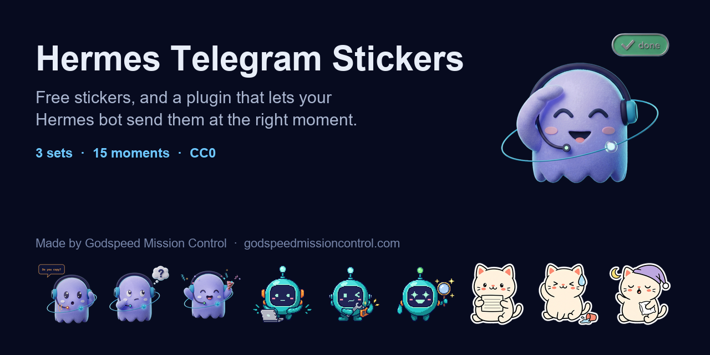
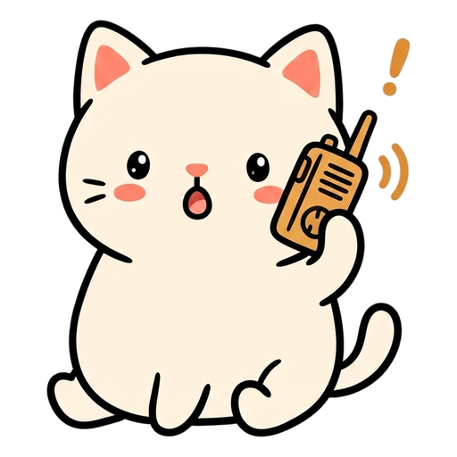
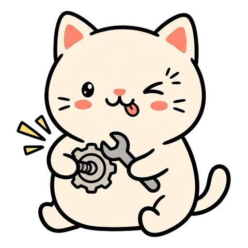

<p align="center"></p>

<p>
  <a href="LICENSE"></a>
  <a href="https://godspeedmissioncontrol.com"></a>
  <a href="https://t.me/addstickers/speedy_by_GodspeedStickersBot"></a>
</p>

# Hermes Telegram Stickers

Free Telegram stickers for [Hermes Agent](https://github.com/NousResearch/hermes-agent), and a
plugin that lets your Hermes bot send one at the right moment: when it finished a job, when it
needs your yes, when it is fixing something.

Made by [Godspeed Mission Control](https://godspeedmissioncontrol.com), the free personal AI you
run yourself on Hermes. Its manual is the book [*Teach It Once*](https://leanpub.com/teachitonce).

[](https://ko-fi.com/michaelc0de)

Three sets with the same fifteen moments, so switching sets is one setting.

**Speedy**, a soft felt cloud ghost, the mascot of
[Godspeed Mission Control](https://godspeedmissioncontrol.com). Running Godspeed on a server?
[Its guide page](https://godspeedmissioncontrol.com/guide/stickers) installs these in four steps.
Add them: https://t.me/addstickers/speedy_by_GodspeedStickersBot

<p>


</p>

**Bit**, a pixel art robot.
Add them: https://t.me/addstickers/bit_by_GodspeedStickersBot

<p>


</p>

**Mochi**, an ink doodle cat.
Add them: https://t.me/addstickers/mochi_by_GodspeedStickersBot

<p>






</p>

## Let your Hermes bot send them

Install the plugin and restart the gateway:

```sh
hermes plugins install MichaelZelbel/hermes-telegram-stickers/hermes-plugin --enable
hermes gateway restart
```

Then tell your agent when to use them, for example in `~/.hermes/SOUL.md`:

> When you finish something I asked for, end your reply with `[[sticker:done]]`.
> When you need my yes on something, end it with `[[sticker:copy]]`.

The plugin sends the sticker through your own bot and removes the tag, so you only see the
sticker and the words. To use Bit or Mochi instead of Speedy, put `STICKERS_SET=bit` or
`STICKERS_SET=mochi` in `~/.hermes/.env`. Settings and details:
[hermes-plugin/README.md](hermes-plugin/README.md).

## The tags

Every set has all fifteen. The word in front is what your agent writes, as in
`[[sticker:done]]`.

- `today` 🎧 here and listening
- `onit` 💻 on it
- `note` 📝 a note for you
- `copy` 📡 do you copy? I need your yes
- `fix` 🔧 fixing it
- `done` 🫡 done
- `quiet` 😴 keeping quiet watch
- `ok` 👍 got it
- `think` 🤔 thinking it over
- `found` 🔍 found it
- `oops` 😅 my mistake
- `party` 🎉 good news
- `thanks` 🙏 thank you
- `morning` ☕ good morning
- `night` 🌙 good night

## Why your bot looks the stickers up itself

Telegram gives every bot its own id for the same sticker, and an id from one bot does not work
for another. So this repository ships no ids: the plugin asks Telegram for the set through your
bot the first time it needs a sticker, and finds each sticker by its first emoji.
`scripts/file-ids.py` does the same lookup by hand.

## Add your own set

Put your PNGs and a `manifest.json` in `packs/<your-set>/` and open a pull request. The details
are in [CONTRIBUTING.md](CONTRIBUTING.md).

## Run the tests

```sh
python3 -m unittest discover -s tests -v
```

They never reach Telegram: a small stand-in for the Bot API runs on your machine. Run them with a
Python that can import Hermes and they also install the plugin into a throwaway Hermes home and
run a real Hermes gateway against that stand-in.

## Who made this

[Michael Zelbel](https://zelbel.com), and the personal AI he builds in the open.

- **[Godspeed Mission Control](https://godspeedmissioncontrol.com)**: a free personal AI that
  lives in a folder you own, runs on Hermes, and messages you only when something matters.
  [Install it](https://godspeedmissioncontrol.com/install).
- **[*Teach It Once*](https://leanpub.com/teachitonce)**: the book that builds it with you, step
  by step. Free sample on the page.
- **[Hermes DevOps Kit](https://ko-fi.com/s/29efd32495)**: keeps your Hermes server running for
  you. Restarts a dead gateway, updates overnight with a rollback, watches your spend. Free to
  take, pay what it is worth to you.
- **[The newsletter](https://michaelzelbel.substack.com/subscribe)**: what my AI does for me and
  what I will not let it do. Free.
- **[YouTube](https://www.youtube.com/@michaelzelbel)**

If the stickers made your bot a little nicer to talk to, a star on this repository helps other
Hermes users find them.

## License

Everything here, the artwork included, is [CC0](LICENSE): public domain. Use it, change it,
repackage it, no credit needed.

This is a community project. It is not made by or affiliated with Nous Research, the makers of
Hermes Agent.
